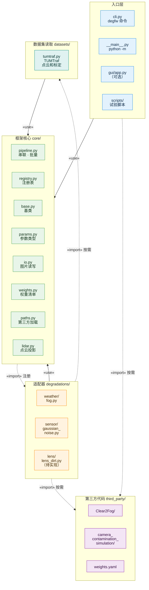
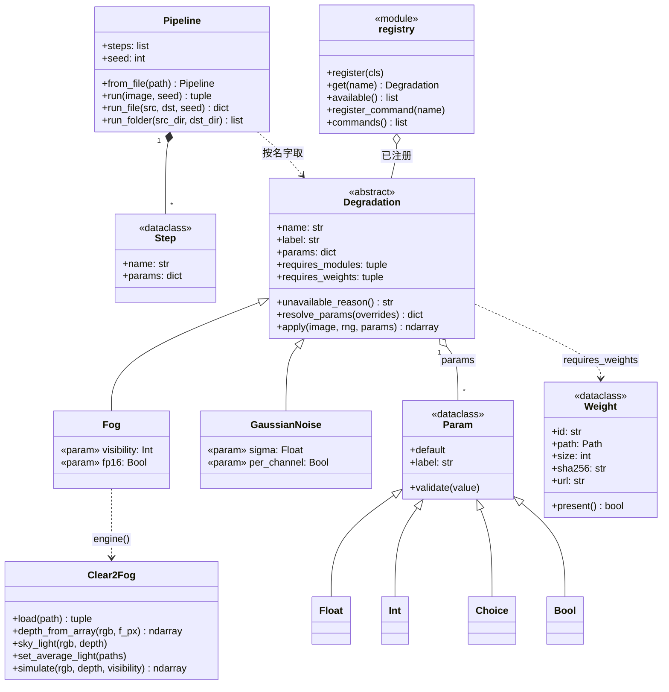
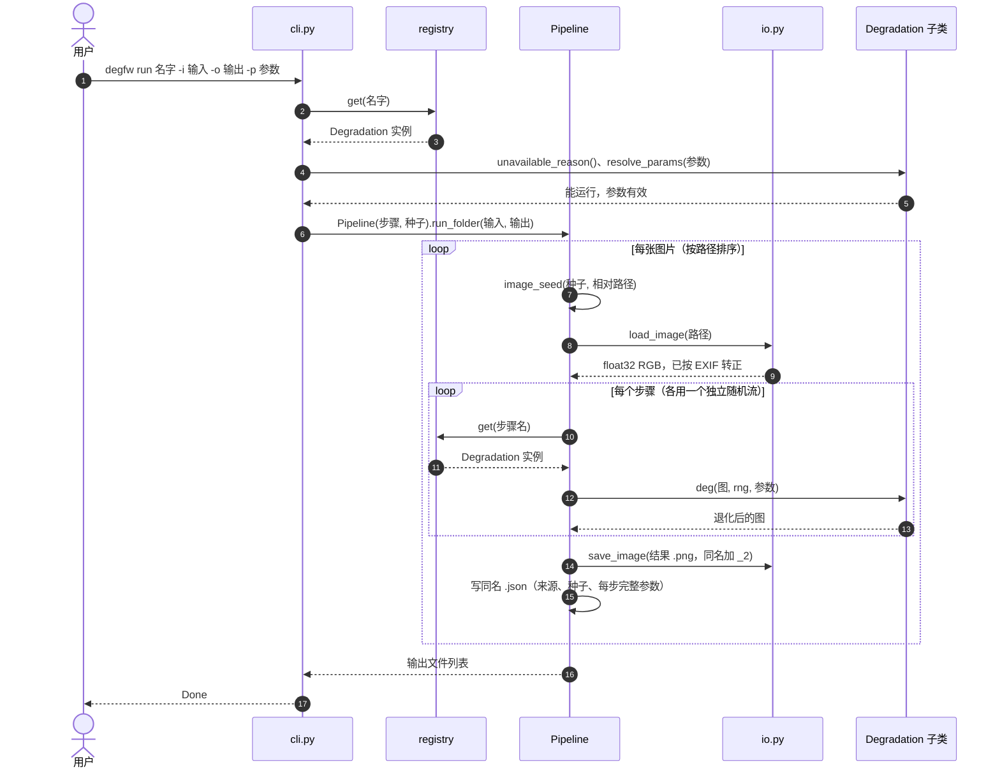
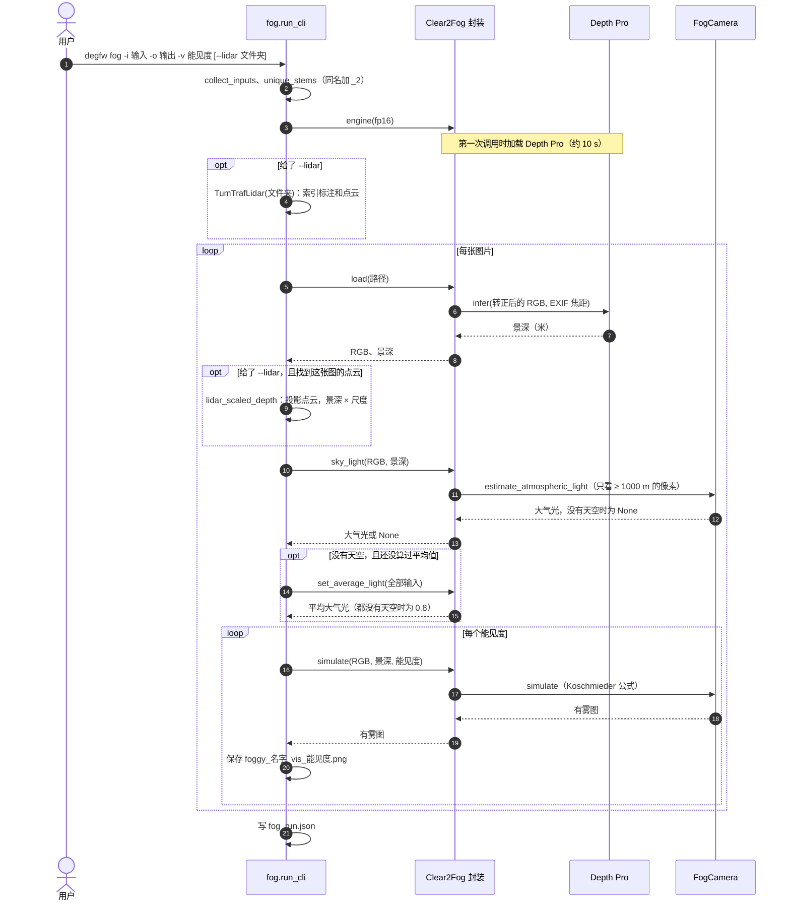

# 系统架构

当前状态：2026-11-19。增删模块、改变依赖关系或调用顺序时，更新这里的图和表。

按三个视图描述，每个视图用对应的 UML 图：

| 视图 | 回答什么问题 | 图 |
|---|---|---|
| 1. 分层结构 | 代码分几层，层与层之间谁依赖谁 | UML 包图（分层） |
| 2. 核心类 | 有哪些核心抽象，它们的继承、组合、依赖关系 | UML 类图 |
| 3. 运行时流程 | 一次命令里各对象按什么顺序调用，数据怎么流动 | UML 时序图 |

另外，第 4 节写输入与输出（给什么、得到哪些文件、元数据里有什么），第 5 节写贯穿各模块的约定。

## 1. 分层结构



图例：实线 = 启动时就导入；虚线 = 运行时第一次用到才导入。
箭头上的字：«use» = 调用、继承下一层；«import» 注册 = 第一次查询时导入适配器，触发注册；«import» 按需 = 用到时才经 `core/paths.py` 加载第三方代码。

- **核心层**不依赖任何具体退化，也不依赖 `third_party/`：`registry.py` 只在第一次查询时导入 `degradations` 包来触发注册。
  所以只装核心依赖（不装 torch 等）时，框架和快速测试照样能运行。
- **适配器**只依赖核心层。第三方代码只通过 `core/paths.py` 加载，而且只在用到时加载：一个第三方仓库缺依赖或缺权重，
  只会让它自己的退化标为不可用（`degfw list` 写明原因），不影响其他部分。
- **入口层**里没有具体退化的代码：`degfw run <名字>` 对所有退化通用；个别退化需要专门命令时自己注册（如 `degfw fog`）。
- **数据集读取** `datasets/`：把某个数据集的文件和标定整理成框架通用的形式（如 `core/lidar.py` 的 `LidarView`）。现在只有 TUMTraf 的点云和标定，供 `degfw fog --lidar` 用（[决策 0008](decisions/0008-fog-lidar-depth-scale.md)）；M6 的数据集适配器接口也会放在这里。
- 镜头污染目前只能通过 `scripts/contamination_examples.py` 运行，还没有接入框架。

### 各模块的依赖明细

"用到时"表示在函数里导入，不在启动时导入。

| 模块 | 依赖的项目内模块 | 备注 |
|---|---|---|
| `degradation_fw/__init__.py` | core.base、core.params、core.pipeline、core.registry | 对外接口 |
| `__main__.py` | cli | |
| `cli.py` | core.registry、core.pipeline；用到时：core.weights、gui.app | |
| `gui/app.py` | core.registry、core.io、core.params、core.pipeline | 需要 gradio |
| `core/pipeline.py` | core.registry、core.io | |
| `core/registry.py` | core.base；第一次查询时：degradations | |
| `core/base.py` | core.params；用到时：core.weights | |
| `core/weights.py` | core.paths | 读 `third_party/weights.yaml` |
| `core/io.py`、`core/params.py`、`core/paths.py`、`core/lidar.py` | 无 | |
| `datasets/tumtraf.py` | core.lidar | 读 TUMTraf 的 OpenLABEL 标注和点云文件名 |
| `degradations/__init__.py` | weather.fog、sensor.gaussian_noise | 导入即注册 |
| `degradations/weather/fog.py` | core.base、core.params、core.registry、core.io、core.paths、core.weights、core.lidar；用到时：Clear2Fog、datasets.tumtraf | |
| `degradations/sensor/gaussian_noise.py` | core.base、core.params、core.registry | |
| `scripts/contamination_examples.py` | core.paths、core.weights；camera_contamination_simulation | |

核对时用：`grep -rnE "^\s*from (\.|degradation_fw)" degradation_fw scripts`

## 2. 核心类



- `Degradation` 是抽象基类，子类实现 `apply()`，随机数只能用传入的 `rng`。
  `Degradation.__call__(image, rng, **params)` 先补默认值、校验参数（`resolve_params`），再调用子类的 `apply`，最后把结果限制在 `[0, 1]`。
- `Pipeline` 按步骤名从注册表取到退化（`registry.get`）；`registry` 保存所有已注册的子类。
- `Clear2Fog` 是 `weather/fog.py` 里对第三方代码的封装（Depth Pro 模型 + `FogCamera`），由 `engine()` 只创建一次，供 `Fog` 和 `degfw fog` 共用。

## 3. 运行时流程

### 3.1 `degfw run` / `degfw apply`（GUI 的批量处理同理）



- `degfw apply` 的区别只在开头：步骤和种子来自 YAML 配置（`Pipeline.from_file`），可以串联多个退化。
- 输入是单个文件时走 `run_file`（没有外层循环，种子直接用配置的种子）；输入是文件夹时，输出文件夹里还会存一份这次用的 `pipeline.yaml`。

### 3.2 `degfw fog`（雾的专门命令）



方法和参数的细节见 [degradations/fog.md](degradations/fog.md)。

## 4. 输入与输出

一句话：**输入数据是图片；怎么处理由配置决定；模型权重这类运行需要的东西属于资源；
输出是退化后的图片，以及每张图一份能复现结果的元数据**。
入口有好几个，处理路径只有两条：通用的 `Pipeline` 路径，以及雾的专门命令 `degfw fog`。

### 4.1 输入数据、配置、资源和输出位置

系统真正的输入只有要处理的数据；其余几项要么决定"怎么处理"（配置），要么是运行需要的环境（资源）。

| 类别 | 是什么 | 每次运行会变吗 | 从哪里给 |
|---|---|---|---|
| **输入数据** | 图片：单个文件或文件夹（连子文件夹），支持 .png .jpg .jpeg .bmp .tif .tiff .webp。以后经数据集适配器读入各种数据集的序列和标注（M6，第一个示例是 TUMTraf A9）。可选：LiDAR 点云和标定，现在只有雾用（TUMTraf 的 OpenLABEL 标注） | 会 | `-i`；点云：`degfw fog --lidar` |
| **配置** | 用哪些退化、各自的参数、种子 | 会 | 配置文件 `configs/*.yaml`（`degfw apply -c`）。`degfw run 名字 -p 参数=值 --seed N` 和 GUI 控件是同一类东西的简便写法 |
| **资源** | 模型权重（`third_party/weights.yaml`）、代码版本和依赖（git 提交、`uv.lock`） | 不会，属于运行环境 | `uv sync`、`uv run degfw weights --download` |
| **输出位置** | 结果写到哪里 | 会 | `-o` |

各类怎么处理：

- **输入数据**：读入时按 EXIF 方向转正，统一转成 float32 RGB `[0, 1]`。
- **配置**：每个参数按退化声明的范围检查，没给的用默认值；处理文件夹时，每张图的种子由（种子, 相对路径）算出（[决策 0003](decisions/0003-folder-seeds.md)）。
  用过的配置会记进输出：处理文件夹时有一份 `pipeline.yaml`，每张图的 `.json` 里有种子和每步的完整参数。
- **资源**：缺了的退化标为不可用（`degfw list` 写明原因），测试自动跳过。
  现在每张图的元数据只记来源和配置，不记代码和权重的版本：要复现结果，需要同一个 git 提交和同样的权重（`weights.yaml` 里有 SHA-256 可以核对）。

### 4.2 输出：`degfw run` / `degfw apply` / GUI 批量处理

```
degfw apply -c configs/fog50.yaml -i data/input -o outputs/run1

data/input/                     outputs/run1/
├── cam1/0001.jpg       →       ├── pipeline.yaml       这次用的配置
├── cam1/0002.jpg               ├── cam1/0001.png       结果，一律存成 .png
└── cam2/0001.png               ├── cam1/0001.json      这张图的元数据
                                ├── cam1/0002.png  + .json
                                └── cam2/0001.png  + .json
```

- 输出保持输入的子文件夹结构；同一个文件夹里主名相同的图（`a.jpg` 和 `a.png`）输出为 `a.png` 和 `a_2.png`（[决策 0005](decisions/0005-output-name-collisions.md)）。
- 每张图旁边的 `.json` 记着重做这张图需要的全部信息。配置的种子是 0 时，`cam1/0001.jpg` 的种子就是下面这个值：

```json
{
  "source": "data\\input\\cam1\\0001.jpg",
  "seed": 6542102234274946371,
  "steps": [
    {"name": "fog", "params": {"visibility": 50, "fp16": false}}
  ]
}
```

- 只重做一张图：`Pipeline.from_file("outputs/run1/pipeline.yaml").run_file(原图, 输出, seed=json 里的 seed)`。
- 输入是单个文件时，`-o` 就是输出文件名（如 `out.png`），旁边生成 `out.json`，不生成 `pipeline.yaml`。
- GUI 的单张图模式：结果和元数据显示在界面上，不自动存文件。脚本里用 `Pipeline.run(图)`，直接返回（结果图, 元数据）。

### 4.3 输出：`degfw fog`（雾的专门命令，用法同原版 `c2f.py`）

```
degfw fog -i data/input/cam1 data/input/cam2 -o outputs/fog -v 50 200

outputs/fog/
├── foggy_0001_vis_50.png        cam1/0001.jpg，能见度 50 m
├── foggy_0001_vis_200.png
├── foggy_0001_2_vis_50.png      cam2/0001.png 也叫 0001，所以加了 _2
├── foggy_0001_2_vis_200.png
└── fog_run.json                 整次运行一份
```

和 4.2 的区别：只读文件夹本层的 .png .jpg .jpeg（不进子文件夹）；所有结果放在同一个文件夹；每个能见度各出一张，景深只算一次；
有 EXIF 焦距就用上；没有天空的图用整批图的平均大气光；加了 `--lidar` 时用点云校正景深的尺度。

`fog_run.json` 的字段：

| 字段 | 内容 |
|---|---|
| `method` | `"Clear2Fog"` |
| `visibility_m` | 这次的能见度列表（米） |
| `depth_pro_precision` | `"float32"` 或 `"float16"` |
| `lidar` | `--lidar` 给的文件夹，没给时为 `null` |
| `average_light` | 只在有图没有天空时出现：平均大气光的值，以及其中有天空的图片数 |
| `images` | 每张输入一项，键是输出用的名字（如 `0001`、`0001_2`）：`source`（原图路径）、`outputs`（对应的输出文件）、`atmospheric_light`（`sky` 或 `average of input set`）、`depth_m`（景深的最小值和中位数，用了 LiDAR 时是校正后的）、`depth`（景深来源：`depth_pro` 或 `depth_pro+lidar_scale`；用了 LiDAR 时有尺度 `lidar_scale`、点数 `lidar_points`、校正后的误差 `lidar_rel_error`、用到的标注和点云 `lidar_frames`；没用上时有原因 `lidar_not_used`） |

### 4.4 现在还做不到的

- **只处理图片，不读目标标注，也不处理序列**（雾可以额外读 TUMTraf 的点云和标定，见 3.2）：各种数据集的序列和标注怎么经数据集适配器读入、怎么跟着退化后的图片一起输出，
  是 M6 的事（第一个示例是 TUMTraf A9）；
  序列里各帧的退化保持一致是 M3 的事（见 [roadmap.md](roadmap.md)、[requirements.md](requirements.md) 的 F1、F6、F8）。
- **退化只能输出一张图**：镜头污染的 mask 还输出不了，这是 M3 要先决定的接口问题。

## 5. 贯穿各模块的约定

| 方面 | 约定 | 在哪里 |
|---|---|---|
| 图像 | `float32`、`H x W x 3`、RGB、`[0, 1]`；读图时按 EXIF 转正，输出不带方向标记 | `core/io.py`、[决策 0004](decisions/0004-exif-orientation.md) |
| 随机数 | 退化只能用传入的 `rng`；每个步骤一个独立随机流；批量时每张图的种子由（种子, 相对路径）算出 | `core/pipeline.py`、[决策 0003](decisions/0003-folder-seeds.md) |
| 元数据 | 每张结果旁一个同名 `.json`：来源、种子、每步的完整参数；同名输出加 `_2` | `core/pipeline.py`、[决策 0005](decisions/0005-output-name-collisions.md) |
| 注册 | `degradations/__init__.py` 导入即注册；适配器文件开头不加载重依赖 | `core/registry.py`、`degradations/_template.py` |
| 第三方代码 | 只复制需要的文件到 `third_party/`，只在这里维护；加载、依赖组、权重清单的约定 | [决策 0001](decisions/0001-third-party-vendoring.md)、[决策 0002](decisions/0002-third-party-integration.md) |
