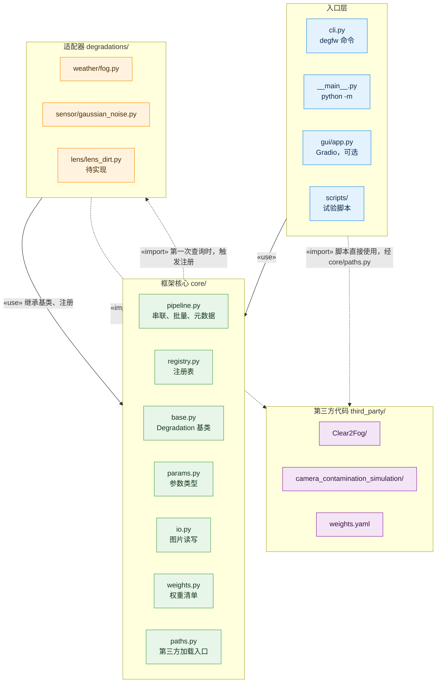
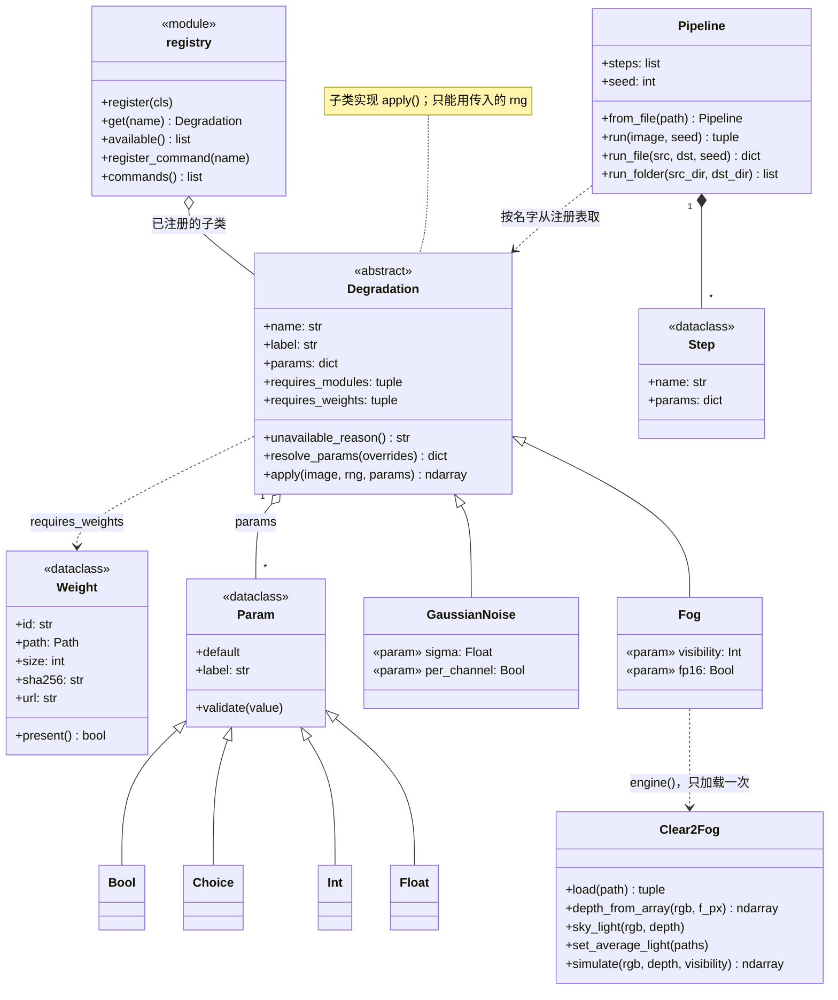
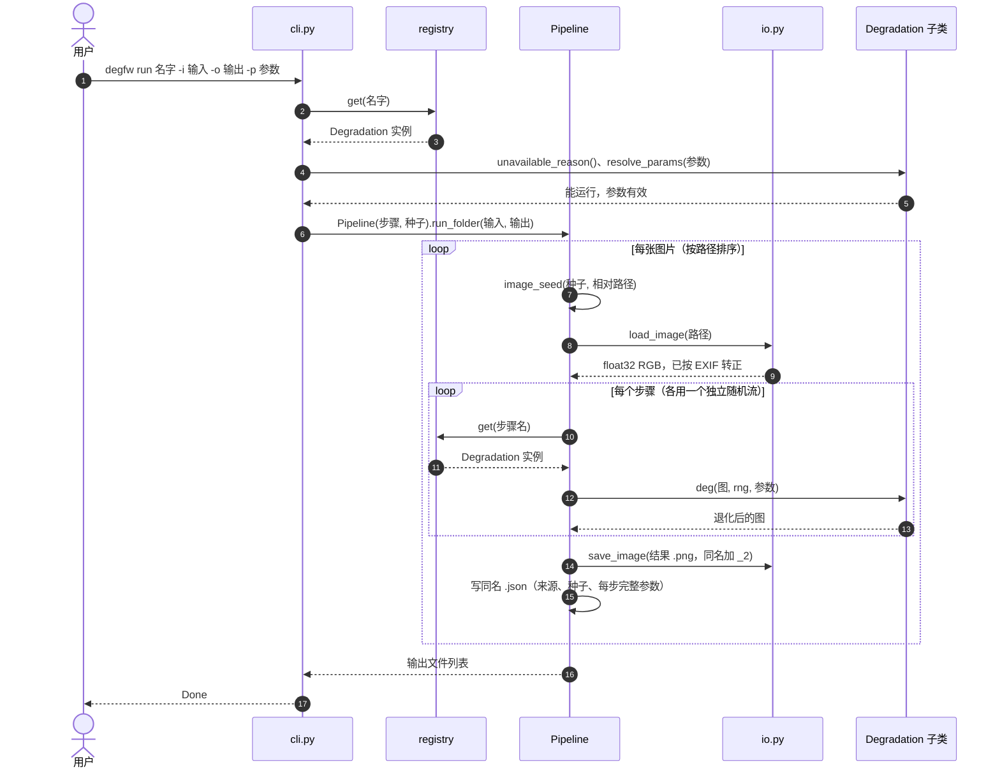
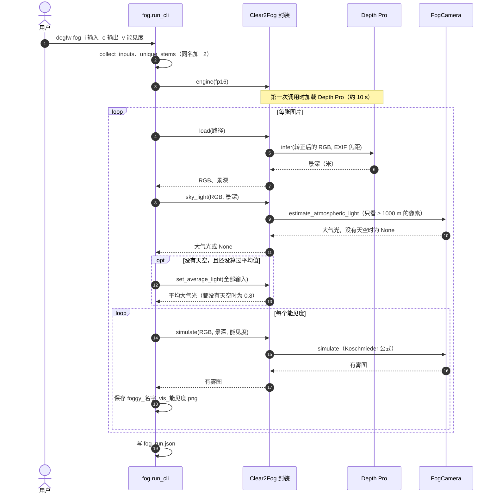

# 系统架构

当前状态：2026-11-19。增删模块、改变依赖关系或调用顺序时，更新这里的图和表。

按三个视图描述，每个视图用对应的 UML 图：

| 视图 | 回答什么问题 | 图 |
|---|---|---|
| 1. 分层结构 | 代码分几层，层与层之间谁依赖谁 | UML 包图（分层） |
| 2. 核心类 | 有哪些核心抽象，它们的继承、组合、依赖关系 | UML 类图 |
| 3. 运行时流程 | 一次命令里各对象按什么顺序调用，数据怎么流动 | UML 时序图 |

## 1. 分层结构

图例：实线 = 启动时就导入；虚线 = 运行时第一次用到才导入。

- **核心层**不依赖任何具体退化，也不依赖 `third_party/`：`registry.py` 只在第一次查询时导入 `degradations` 包来触发注册。
  所以只装核心依赖（不装 torch 等）时，框架和快速测试照样能运行。
- **适配器**只依赖核心层。第三方代码只通过 `core/paths.py` 加载，而且只在用到时加载：一个第三方仓库缺依赖或缺权重，
  只会让它自己的退化标为不可用（`degfw list` 写明原因），不影响其他部分。
- **入口层**里没有具体退化的代码：`degfw run <名字>` 对所有退化通用；个别退化需要专门命令时自己注册（如 `degfw fog`）。
- 镜头污染目前只能通过 `scripts/contamination_examples.py` 运行，还没有接入框架。

### 各模块的依赖明细

"用到时"表示在函数里导入，不在启动时导入。

| 模块 | 依赖的项目内模块 | 备注 |
|---|---|---|
| `degradation_fw/__init__.py` | core.base、core.params、core.pipeline、core.registry | 对外接口 |
| `__main__.py` | cli | |
| `cli.py` | core.registry、core.pipeline；用到时：core.weights、gui.app | |
| `gui/app.py` | core.registry、core.io、core.params、core.pipeline | 需要 gradio |
| `core/pipeline.py` | core.registry、core.io | |
| `core/registry.py` | core.base；第一次查询时：degradations | |
| `core/base.py` | core.params；用到时：core.weights | |
| `core/weights.py` | core.paths | 读 `third_party/weights.yaml` |
| `core/io.py`、`core/params.py`、`core/paths.py` | 无 | |
| `degradations/__init__.py` | weather.fog、sensor.gaussian_noise | 导入即注册 |
| `degradations/weather/fog.py` | core.base、core.params、core.registry、core.io、core.paths、core.weights；用到时：Clear2Fog | |
| `degradations/sensor/gaussian_noise.py` | core.base、core.params、core.registry | |
| `scripts/contamination_examples.py` | core.paths、core.weights；camera_contamination_simulation | |

核对时用：`grep -rnE "^\s*from (\.|degradation_fw)" degradation_fw scripts`

## 2. 核心类

- `Degradation.__call__(image, rng, **params)` 先补默认值、校验参数（`resolve_params`），再调用子类的 `apply`，最后把结果限制在 `[0, 1]`。
- `Clear2Fog` 是 `weather/fog.py` 里对第三方代码的封装（Depth Pro 模型 + `FogCamera`），由 `engine()` 只创建一次，供 `Fog` 和 `degfw fog` 共用。

## 3. 运行时流程

### 3.1 `degfw run` / `degfw apply`（GUI 的批量处理同理）

- `degfw apply` 的区别只在开头：步骤和种子来自 YAML 配置（`Pipeline.from_file`），可以串联多个退化。
- 输入是单个文件时走 `run_file`（没有外层循环，种子直接用配置的种子）；输入是文件夹时，输出文件夹里还会存一份这次用的 `pipeline.yaml`。

### 3.2 `degfw fog`（雾的专门命令）

方法和参数的细节见 [degradations/fog.md](degradations/fog.md)。

## 4. 贯穿各模块的约定

| 方面 | 约定 | 在哪里 |
|---|---|---|
| 图像 | `float32`、`H x W x 3`、RGB、`[0, 1]`；读图时按 EXIF 转正，输出不带方向标记 | `core/io.py`、[决策 0004](decisions/0004-exif-orientation.md) |
| 随机数 | 退化只能用传入的 `rng`；每个步骤一个独立随机流；批量时每张图的种子由（种子, 相对路径）算出 | `core/pipeline.py`、[决策 0003](decisions/0003-folder-seeds.md) |
| 元数据 | 每张结果旁一个同名 `.json`：来源、种子、每步的完整参数；同名输出加 `_2` | `core/pipeline.py`、[决策 0005](decisions/0005-output-name-collisions.md) |
| 注册 | `degradations/__init__.py` 导入即注册；适配器文件开头不加载重依赖 | `core/registry.py`、`degradations/_template.py` |
| 第三方代码 | 只复制需要的文件到 `third_party/`，只在这里维护；加载、依赖组、权重清单的约定 | [决策 0001](decisions/0001-third-party-vendoring.md)、[决策 0002](decisions/0002-third-party-integration.md) |
