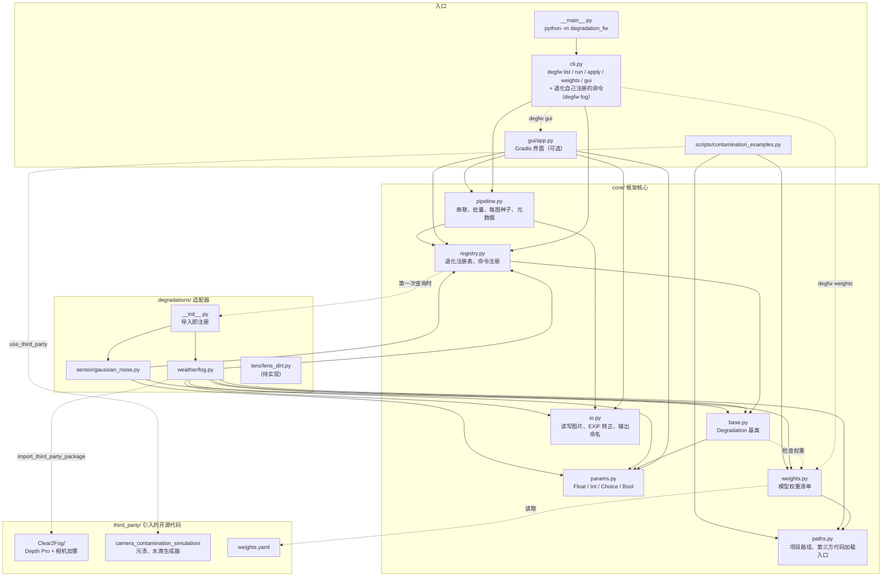
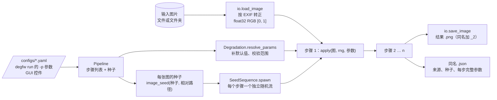
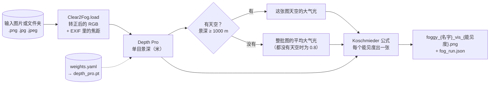

# 系统架构

当前状态：2026-11-19（提交 `929270d` 之后）。增删模块或改变模块之间的依赖时，更新这里的图。

## 1. 模块依赖

箭头 `A --> B` 表示 A 导入 B；虚线是只在用到时才导入（不在启动时）。



要点：

- `core/` 不依赖任何具体退化，也不依赖 `third_party/`；只装核心依赖（不装 torch 等）时框架和快速测试照样能运行。
- 适配器只依赖 `core/`。第三方代码只通过 `core/paths.py` 加载，而且只在第一次用到时加载，所以一个第三方仓库缺依赖或缺权重，
  只会让它自己的退化标为不可用（`degfw list` 会写明原因），不影响其他部分。
- `cli.py` 里没有具体退化的代码：`degfw run <名字>` 对所有退化通用，个别退化需要专门命令时自己注册（如 `degfw fog`）。
- 镜头污染目前只能通过 `scripts/contamination_examples.py` 运行，还没有接入框架（`lens_dirt.py` 待实现）。

## 2. 数据流：`degfw run` / `degfw apply` / GUI

三种入口最后都交给 `Pipeline`：



处理文件夹时，输出文件夹里还会存一份 `pipeline.yaml`（这次用的配置）。

## 3. 数据流：`degfw fog`（雾的专门命令）



方法和参数的细节见 [degradations/fog.md](degradations/fog.md)。

## 4. 贯穿各模块的约定

| 方面 | 约定 | 在哪里 |
|---|---|---|
| 图像 | `float32`、`H x W x 3`、RGB、`[0, 1]`；读图时按 EXIF 转正，输出不带方向标记 | `core/io.py`、[决策 0004](decisions/0004-exif-orientation.md) |
| 随机数 | 退化只能用传入的 `rng`；每个步骤一个独立随机流；批量时每张图的种子由（种子, 相对路径）算出 | `core/pipeline.py`、[决策 0003](decisions/0003-folder-seeds.md) |
| 元数据 | 每张结果旁一个同名 `.json`：来源、种子、每步的完整参数；同名输出加 `_2` | `core/pipeline.py`、[决策 0005](decisions/0005-output-name-collisions.md) |
| 注册 | `degradations/__init__.py` 导入即注册；适配器文件开头不加载重依赖 | `core/registry.py`、`degradations/_template.py` |
| 第三方代码 | 原样复制到 `third_party/`，只在这里维护；加载、依赖组、权重清单的约定 | [决策 0001](decisions/0001-third-party-vendoring.md)、[决策 0002](decisions/0002-third-party-integration.md) |

查看某个模块实际导入了哪些项目内模块（更新上面的图时用）：

```
grep -rnE "^\s*from (\.|degradation_fw)" degradation_fw scripts
```
