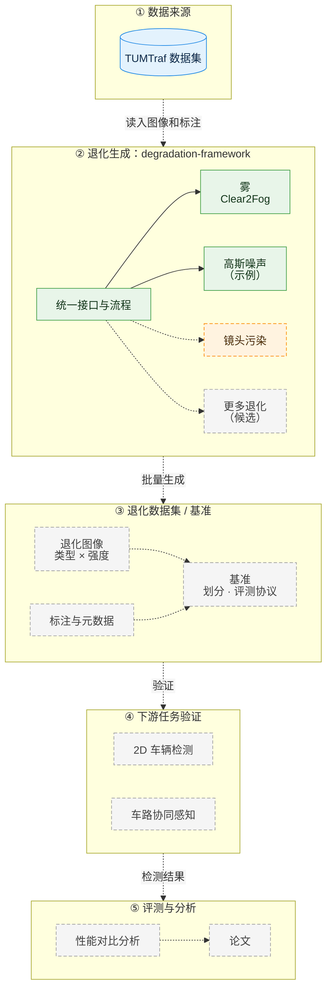

# 路线图

**论文主线**：

1. 退化生成方法：雾、镜头污染等退化的合成；
2. 在 TUMTraf 数据上构建退化数据集 / 基准，用 2D 车辆检测和车路协同感知验证。

本仓库（degradation-framework）负责第 1 项，以及第 2 项里的批量生成。

本仓库内部的模块结构见 [architecture.md](architecture.md)，做过的关键决定见 [decisions/](decisions/README.md)，每周进展见 [status/](status/)。

## 论文项目总体架构

图例：绿色实线框 = 已完成；橙色虚线框 = 进行中；灰色虚线框 = 计划中；蓝色 = 外部数据。
实线箭头 = 已经打通的数据流；虚线箭头 = 计划中的数据流。

| 部分 | 说明 | 状态（里程碑） |
|---|---|---|
| TUMTraf 数据集 | 路侧 / 车路协同场景的图像和标注，作为干净图像的来源 | 外部数据，接入计划中（M5） |
| 统一接口与流程 | 参数校验、每图种子、批量处理、元数据 | 已完成（M0、M2） |
| 雾 | Clear2Fog：单目景深 + 大气散射模型 | 已完成（M1） |
| 高斯噪声 | 示例，用来验证框架 | 已完成 |
| 镜头污染 | 不透明污渍、半透明污渍、水滴 | 进行中（M3） |
| 更多退化 | 候选：雨、另一种合成雾、物理镜头脏污 | 计划中（M4） |
| 退化图像 | 按退化类型 × 强度等级生成 | 计划中（M6） |
| 标注与元数据 | 原标注 + 退化类型、参数、种子 + 污染 mask | 计划中（M6） |
| 基准 | 数据划分、评测协议 | 计划中（M6） |
| 2D 车辆检测、车路协同感知 | 在基准上验证 | 计划中（M7） |
| 性能对比分析 | 各退化类型、强度下的性能，与干净数据对比 | 计划中（M8） |

## 里程碑

| | 里程碑 | 内容 | 状态 |
|---|---|---|---|
| M0 | 框架骨架 | `core/`（基类、参数、注册表、流程、读写）、命令行、通用测试、Gradio 初版 | ✅ 2026-11-12 |
| M1 | 雾 | Clear2Fog 适配器和 `degfw fog`；float32 与原版逐像素一致，`--fp16` 快约 20 倍 | ✅ 2026-11-19 |
| M2 | 工程结构 | 第三方代码约定（加载、依赖组、权重清单）、`degfw run` / `degfw weights`、测试拆分和回归测试；修复 EXIF 方向、批量种子、同名覆盖 | ✅ 2026-11-19 |
| M3 | 镜头污染 | `lens/lens_dirt.py`：不透明污渍、半透明污渍、水滴接入框架 | ⏳ 下一步 |
| M4 | 更多退化 | 见下面的候选 | 计划中 |
| M5 | 接入 TUMTraf | 读入图像和标注，按配置批量生成退化 | 计划中 |
| M6 | 退化数据集 / 基准 | 退化类型 × 强度等级；标注与退化元数据；数据划分和评测协议 | 计划中 |
| M7 | 下游任务验证 | 2D 车辆检测、车路协同感知在基准上的表现 | 计划中 |
| M8 | 分析与论文 | 各退化类型、强度下的性能对比，写进论文 | 计划中 |
| — | 图形界面 | 在 Gradio 初版上完善 | 暂缓（可选） |

## 要决定的事

**M3 镜头污染，开始前：** 污染代码已经引入（`third_party/camera_contamination_simulation`），可以用 `scripts/contamination_examples.py` 单独运行，
但还没有接入框架。现在的退化接口满足不了它的两个需求，要先定方案，写成决策记录：

1. **输出 mask**：污染需要同时输出 mask，而 `Degradation.apply` 只能返回一张图。
2. **非数值参数**：污渍的位置（可能有好几处，每处 x、y、大小）和 RGB 颜色不是单个数值，而现有参数类型只有 Float、Int、Choice、Bool。

**M5–M6 数据集 / 基准，开始前：**

1. TUMTraf 用哪些子集、哪些相机。
2. 强度等级怎么分，例如雾按能见度分几档。
3. 镜头污染遮挡了目标时，标注怎么处理：保留原标注，还是按遮挡程度调整或剔除。

## M4 候选（尚未评估）

本机 GitHub 文件夹里还有这几个和退化相关的仓库，要不要引入待评估：

- `Rain-Generation-Python`：雨
- `fog_simulation-SFSU_synthetic`：另一种合成雾的方法（Foggy Cityscapes）
- `physical_lens_soiling`：基于物理仿真的镜头脏污

## 可选的工程改进

- **CI**：快速测试不需要 GPU 和第三方依赖，可以在 GitHub Actions 上只装核心依赖来跑。
- **拆分 `weather/fog.py`**：它现在约 280 行，再加功能时拆成子包（模型封装 / 注册的退化 / 命令行）。
- **雾的示例配置**：`configs/` 里加一个。
