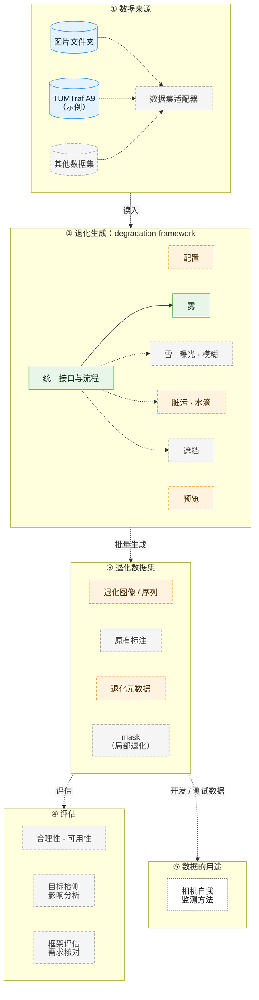

# 路线图

**论文**：*Development and Evaluation of a Modular Framework for Generating Degraded Camera Data for Stationary Infrastructure Cameras*
（2026-09-02 下发，**2027-03-02 提交**）。

**目的**：为相机自我监测方法的开发和评估，生成退化类型和强度已知、可复现的相机数据。
任务书拆成的需求见 [requirements.md](requirements.md)（编号 F / N / E / D），下面的里程碑都对应到这些编号。

本仓库内部的模块结构见 [architecture.md](architecture.md)，做过的关键决定见 [decisions/](decisions/README.md)，每周进展见 [status/](status/)。

## 论文项目总体架构

图例：绿色实线框 = 已完成；橙色虚线框 = 进行中或部分完成；灰色虚线框 = 计划中；蓝色 = 外部数据；
白色点线框 = 论文之外的使用方。实线箭头 = 已经打通；虚线箭头 = 计划中。

| 部分 | 说明 | 需求 | 状态 |
|---|---|---|---|
| 数据集适配器 | 把不同数据集的组织方式（图像、序列）和标注格式接到框架的统一表示上，导出时按原格式写回；框架不绑定任何一个数据集，新增数据集只加一个适配器 | F1、F2、F8、N1 | 计划中（M6） |
| 图片文件夹 | 不带标注的普通图片，现在就能直接处理 | F1 | ✅ |
| TUMTraf A9 | 路侧基础设施相机数据集，第一个适配的示例 | F1 | 点云和标定已能读，雾用来校正景深（`degfw fog --lidar`）；图像、序列、标注的适配器计划中（M6） |
| 其他数据集 | 以后按需要加适配器 | F1 | — |
| 配置 | 数据集 / 子集、退化类型、强度等级、种子都写在配置文件里 | F2、F4、F10 | 退化、参数、种子 ✅；子集、强度 ❌ |
| 统一接口与流程 | 参数检查、每张图的种子、批量处理、元数据 | F5、F9、N1 | 已完成（M0、M2） |
| 预览 | 生成整个数据集之前看效果 | F7 | 有 Gradio 初版，要跟上新功能（M7） |
| 雾 | Clear2Fog：单目景深 + 大气散射模型；有 LiDAR 时用点云校正景深的尺度 | F3 | 已完成（M1）；LiDAR 校正 11-24（[决策 0008](decisions/0008-fog-lidar-depth-scale.md)） |
| 雪、曝光、模糊 | 其余全局退化 | F3 | 计划中（M5） |
| 脏污、水滴 | 镜头污染：不透明 / 半透明污渍、水滴 | F3 | 代码已引入，接入进行中（M4） |
| 遮挡 | 局部退化 | F3 | 计划中（M4） |
| 退化图像 / 序列 | 输出的退化数据；序列要在时间上一致 | F6、F8 | 图像 ✅；序列 ❌ |
| 原有标注 | 跟着退化后的图像一起导出 | F8 | 计划中（M6） |
| 退化元数据 | 每张图的类型、强度、参数、种子 | F8、F9 | 参数和种子 ✅；强度 ❌ |
| mask | 局部退化影响到的区域 | F8 | 计划中（M3、M4） |
| 合理性、可用性 | 生成的退化是否可信、是否可用于自我监测 | E1、E2 | 计划中（M8） |
| 目标检测影响分析 | 一种目标检测方法在不同退化、不同强度下的表现 | E4 | 计划中（M9） |
| 框架评估 | 对照需求逐条核对 | E3 | 计划中（M10） |
| 相机自我监测方法 | 生成数据的使用方，不在论文范围内 | — | — |

## 里程碑

| | 里程碑 | 内容 | 需求 | 状态 |
|---|---|---|---|---|
| M0 | 框架骨架 | `core/`（基类、参数、注册表、流程、读写）、命令行、通用测试、Gradio 初版 | N1、F5 | ✅ 2026-11-12 |
| M1 | 雾 | Clear2Fog 适配器和 `degfw fog`；float32 与原版逐像素一致，`--fp16` 快约 20 倍 | F3 | ✅ 2026-11-19 |
| M2 | 工程结构 | 第三方代码约定、`degfw run` / `degfw weights`、测试拆分和回归测试；修复 EXIF 方向、批量种子、同名覆盖 | N1、N2、F9 | ✅ 2026-11-19 |
| M3 | 接口扩展 | 退化可以输出 mask、一张图出多个版本、拿到来源和整批信息、序列内保持一致、强度等级；两条输出路径统一（`degfw fog` 也按统一格式输出） | F4、F6、F8 | ⏳ 下一步 |
| M4 | 局部退化 | 脏污、水滴接入框架（带 mask）；遮挡 | F3、F8 | 计划中 |
| M5 | 全局退化 | 雪、曝光不良、模糊；每种退化的强度等级表 | F3、F4 | 计划中 |
| M6 | 数据集接口 | 数据集适配器接口（图像、序列、标注的统一表示，标注按原格式导出）；第一个适配器 TUMTraf A9 作为示例；按子集选择；导出带标注的退化数据集 | F1、F2、F8、F10、N1 | 计划中 |
| M7 | 预览 | 更新 Gradio 界面：选图片、退化、强度，对比预览 | F7 | 计划中 |
| M8 | 合理性和可用性评估 | 和真实退化数据对比；检查强度等级和标签 | E1、E2 | 计划中 |
| M9 | 目标检测影响分析 | 一种目标检测方法在干净数据和各退化、各强度下的评测 | E4 | 计划中 |
| M10 | 框架评估与论文定稿 | 对照需求逐条核对；论文定稿 | E3 | 计划中 |

调研和论证（D1、D2）从现在起和开发同步写进论文；选择退化的理由写成决策记录。

## 时间表（建议，按实际进度调整）

| 时间 | 里程碑 | 备注 |
|---|---|---|
| 11-23 ~ 12-06（2 周） | M3 接口扩展 | 先看几个典型数据集（如 TUMTraf A9）的数据组织和标注格式，接口设计要用到 |
| 12-07 ~ 12-20（2 周） | M4 局部退化 | |
| 12-21 ~ 01-03（2 周） | M5 全局退化 | 含假期 |
| 01-04 ~ 01-17（2 周） | M6 数据集接口（TUMTraf A9 示例）、M7 预览 | |
| 01-18 ~ 02-07（3 周） | M8 合理性和可用性评估、M9 目标检测影响分析 | 两项可以并行 |
| 02-08 ~ 03-02（3 周） | M10 框架评估、论文定稿 | 留出缓冲 |

## 要决定的事

1. **选哪些退化、各用什么方法，理由是什么**（D2、F3）→ 决策 0006。
   候选方法：本机 GitHub 文件夹里的 `Rain-Generation-Python`（雨）、`fog_simulation-SFSU_synthetic`（另一种合成雾）、
   `physical_lens_soiling`（基于物理仿真的镜头脏污），以及已经引入的 Clear2Fog 和 camera_contamination_simulation。
2. **接口怎么扩展**（M3：mask、一张图多个版本、来源和整批信息、序列一致性、强度等级、统一输出路径）→ 决策 0007。
3. **雾的大气光在没有天空时怎么定**（M3，F6、F9）：现在没有天空的图，`degfw fog` 用同一批里有天空的图的平均值，
   `degfw run fog` 固定用 0.8。路侧相机常常拍不到天空，结果就会取决于同一批里还有哪些图，序列里也可能逐帧跳变。
   候选做法：大气光做成可以直接设置的参数（给定值或"自动"）；按相机或按序列只估一次，整段共用；
   天空的距离阈值（现在是 1000 m）可调。方法细节见 [degradations/fog.md](degradations/fog.md)。
4. **数据集接口**（M6）：图像、序列、标注怎么统一表示；标注原样复制还是经适配器读入后再写回；
   镜头污染遮住目标时标注怎么处理；示例数据集 TUMTraf A9 用哪些子集、哪些相机。
5. **强度等级怎么分**：分几档，每档对应什么参数，依据是什么（F4）。
   雾的能见度要可信，景深的尺度就得对：只用 Depth Pro 时，路侧相机上的景深约小 8 倍（[决策 0008](decisions/0008-fog-lidar-depth-scale.md)）。
   有 LiDAR 的数据集用 `--lidar` 校正；没有 LiDAR 的怎么办（例如用相机标定和地平面算尺度），在这里一起定。
6. **合理性和可用性怎么评估**：和哪些真实数据对比、用什么指标（E1、E2）。
   本机的 TSBOW、CoInfra 含真实恶劣天气数据，可以作为对比的候选。
7. **目标检测用哪个方法、什么指标**（E4）。

## 可选的工程改进

- **CI**：快速测试不需要 GPU 和第三方依赖，可以在 GitHub Actions 上只装核心依赖来跑。
- **拆分 `weather/fog.py`**：它现在约 280 行，再加功能时拆成子包（模型封装 / 注册的退化 / 命令行）。
- **元数据记录版本**：每张图的元数据加上代码的 git 提交和权重的版本，复现时不用另外核对（F9）。
