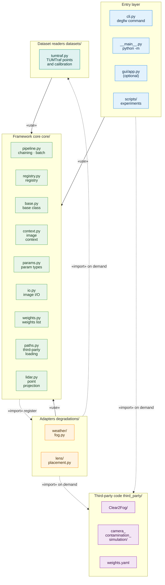
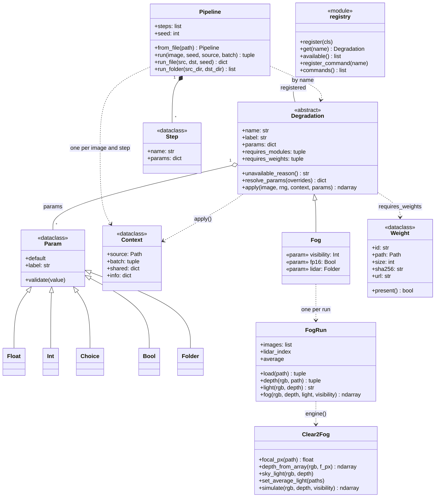
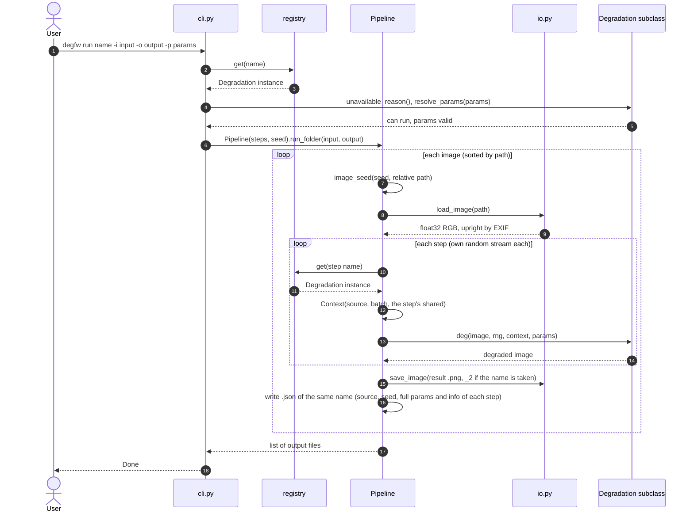
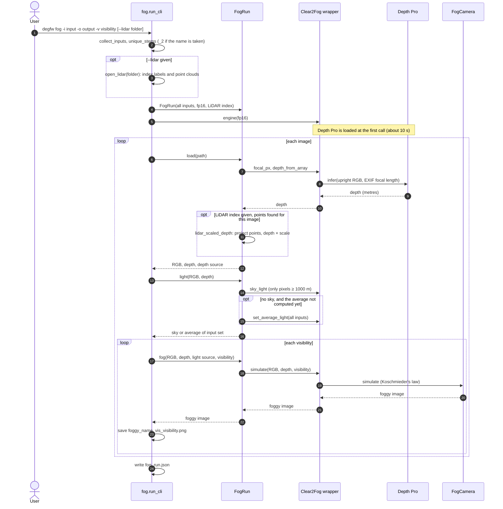

# System architecture

State: 2026-11-25. Update the diagrams and tables here when modules are added or removed, or dependencies or call order change.

Described in three views, each with the corresponding UML diagram:

| View | Question it answers | Diagram |
|---|---|---|
| 1. Layered structure | How many layers the code has, which layer depends on which | UML package diagram (layered) |
| 2. Core classes | The core abstractions and their inheritance, composition and dependencies | UML class diagram |
| 3. Runtime | In which order objects call each other during a command, how the data flows | UML sequence diagrams |

In addition, section 4 covers inputs and outputs (what goes in, which files come out, what the metadata contains), and section 5 the conventions that run through all modules.

## 1. Layered structure



Legend: solid = imported at start-up; dashed = imported at run time, when first needed.
Labels on the arrows: «use» = calls / inherits from the layer below; «import» register = the adapters are imported at the first lookup, which registers them; «import» on demand = third-party code is loaded through `core/paths.py` only when needed.

- The **core** depends on no specific degradation and not on `third_party/`: `registry.py` imports the `degradations` package only at the first lookup, to trigger registration.
  So with only the core dependencies installed (no torch etc.), the framework and the quick tests still run.
- **Adapters** depend only on the core. Third-party code is loaded only through `core/paths.py`, and only when needed: if a third-party repository lacks dependencies or weights,
  only its own degradation is marked unavailable (`degfw list` gives the reason); nothing else is affected.
- The **entry layer** contains no code for specific degradations: `degfw run <name>` works for every degradation; a degradation that needs its own command registers it itself (e.g. `degfw fog`).
- **Dataset readers** `datasets/`: turn a dataset's files and calibration into the framework's common form (e.g. `LidarView` in `core/lidar.py`). For now only TUMTraf point clouds and calibration, used by `degfw fog --lidar` ([decision 0008](decisions/0008-fog-lidar-depth-scale.md)); the dataset adapter interface of M6 will also go here.
- Lens contamination can currently only be run through `scripts/contamination_examples.py`; it is not integrated into the framework yet. The exact placement of water drops ([decision 0009](decisions/0009-droplet-exact-placement.md)) is already in the framework (`degradations/lens/placement.py`), to be reused then.

### Dependencies of each module

"When needed" means imported inside a function, not at start-up.

| Module | Project modules it depends on | Notes |
|---|---|---|
| `degradation_fw/__init__.py` | core.base, core.context, core.params, core.pipeline, core.registry | Public interface |
| `__main__.py` | cli | |
| `cli.py` | core.registry, core.pipeline; when needed: core.weights, gui.app | |
| `gui/app.py` | core.registry, core.io, core.params, core.pipeline | Needs gradio |
| `core/pipeline.py` | core.registry, core.io, core.context | |
| `core/registry.py` | core.base; at the first lookup: degradations | |
| `core/base.py` | core.params, core.context; when needed: core.weights | |
| `core/weights.py` | core.paths | Reads `third_party/weights.yaml` |
| `core/io.py`, `core/params.py`, `core/paths.py`, `core/lidar.py`, `core/context.py` | none | |
| `datasets/tumtraf.py` | core.lidar | Reads TUMTraf OpenLABEL labels and point cloud file names |
| `degradations/__init__.py` | weather.fog | Importing registers them |
| `degradations/weather/fog.py` | core.base, core.params, core.registry, core.io, core.paths, core.weights, core.lidar; when needed: Clear2Fog, datasets.tumtraf | |
| `degradations/lens/placement.py` | none | Exact placement of water drops, numpy only |
| `scripts/contamination_examples.py` | core.paths, core.weights, degradations.lens.placement; camera_contamination_simulation | |

To check: `grep -rnE "^\s*from (\.|degradation_fw)" degradation_fw scripts`

## 2. Core classes



- `Degradation` is the abstract base class; subclasses implement `apply()` and may only use the `rng` passed in for randomness.
  `Degradation.__call__(image, rng, context, **params)` first fills in defaults and validates the parameters (`resolve_params`), then calls the subclass's `apply`, and finally clips the result to `[0, 1]`;
  without a `context` it uses an empty one, as for an image in memory.
- `Context` is what is known about the image besides its pixels ([decision 0010](decisions/0010-context-one-fog-code.md)): its file `source`, all input files of the run `batch`,
  `shared` for the whole run (one per step), and `info`, the degradation's record (written to the `.json`). Most degradations ignore it.
- `Pipeline` gets each step's degradation from the registry by name (`registry.get`); `registry` holds all registered subclasses.
- `Clear2Fog` is the wrapper of the third-party code in `weather/fog.py` (Depth Pro model + `FogCamera`), created only once by `engine()`.
- `FogRun` is the fog's only processing code: one per run, it chains focal length, depth, LiDAR correction, atmospheric light and fog, and keeps what the run shares (LiDAR index, batch-average atmospheric light).
  `Fog` (keeping it in `context.shared`) and `degfw fog` both use it, so both give the same results.

## 3. Runtime

### 3.1 `degfw run` / `degfw apply` (the GUI's batch processing works the same way)



- `degfw apply` differs only at the start: steps and seed come from a YAML configuration (`Pipeline.from_file`), so several degradations can be chained.
- A single input file goes through `run_file` (no outer loop; the seed is the configured seed); for an input folder, the output folder also gets the `pipeline.yaml` used for the run.
- There is one `shared` per `run_folder` call (one per step), dropped when the batch is done; a single-file run has its own.
- The fog (`Fog`) does in this step exactly what 3.2 does for each image: it calls `depth`, `light` and `fog` of the same `FogRun`.
  The `FogRun` is created at the run's first image and kept in `context.shared`; the focal length and the file name for finding point clouds come from `context.source`, the batch average from `context.batch`.

### 3.2 `degfw fog` (the fog's own command)



Details of the method and parameters: [degradations/fog.md](degradations/fog.md).

## 4. Inputs and outputs

In one sentence: **the input data is images; how they are processed is determined by the configuration; things needed to run, such as model weights, are resources;
the output is the degraded images, plus one metadata file per image that is enough to reproduce it**.
There are several entry points but only two processing paths: the general `Pipeline` path, and the fog's own command `degfw fog`.
The two paths write different output formats; on both, the fog uses the same code, so the same images give the same results ([decision 0010](decisions/0010-context-one-fog-code.md)).

### 4.1 Input data, configuration, resources and output location

The system's actual input is only the data to be processed; everything else either determines how it is processed (configuration) or is part of the runtime environment (resources).

| Category | What | Changes between runs? | Given by |
|---|---|---|---|
| **Input data** | Images: a single file or a folder (including subfolders), .png .jpg .jpeg .bmp .tif .tiff .webp. Later, sequences and annotations of various datasets, read through dataset adapters (M6; first example TUMTraf A9). Optional: LiDAR point clouds and calibration, for now only used by the fog (TUMTraf OpenLABEL labels) | Yes | `-i`; point clouds: `degfw fog --lidar` or the fog's parameter `lidar` |
| **Configuration** | Which degradations, their parameters, the seed | Yes | Configuration file `configs/*.yaml` (`degfw apply -c`). `degfw run name -p param=value --seed N` and the GUI controls are shorthands for the same thing |
| **Resources** | Model weights (`third_party/weights.yaml`), code version and dependencies (git commit, `uv.lock`) | No, part of the runtime environment | `uv sync`, `uv run degfw weights --download` |
| **Output location** | Where the results are written | Yes | `-o` |

How each category is handled:

- **Input data**: turned upright by its EXIF orientation when read, converted to float32 RGB `[0, 1]`.
- **Configuration**: every parameter is checked against the range the degradation declares, missing ones get their defaults; in a folder run each image's seed is derived from (seed, relative path) ([decision 0003](decisions/0003-folder-seeds.md)).
  The configuration used is recorded in the output: a `pipeline.yaml` for folder runs, and the seed and full parameters of each step in every image's `.json`.
- **Resources**: a degradation whose resources are missing is marked unavailable (`degfw list` gives the reason), and its tests are skipped.
  The per-image metadata currently records only source and configuration, not code and weight versions: reproducing a result needs the same git commit and the same weights (`weights.yaml` holds their SHA-256 for checking).

### 4.2 Output: `degfw run` / `degfw apply` / GUI batch processing

```
degfw apply -c configs/fog50.yaml -i data/input -o outputs/run1

data/input/                     outputs/run1/
├── cam1/0001.jpg       →       ├── pipeline.yaml       configuration of this run
├── cam1/0002.jpg               ├── cam1/0001.png       result, always .png
└── cam2/0001.png               ├── cam1/0001.json      metadata of this image
                                ├── cam1/0002.png  + .json
                                └── cam2/0001.png  + .json
```

- The output keeps the input's subfolder structure; images with the same stem in one folder (`a.jpg` and `a.png`) become `a.png` and `a_2.png` ([decision 0005](decisions/0005-output-name-collisions.md)).
- The `.json` next to each image holds everything needed to redo it. With seed 0 in the configuration, the seed of `cam1/0001.jpg` is this value:

```json
{
  "source": "data\\input\\cam1\\0001.jpg",
  "seed": 6542102234274946371,
  "steps": [
    {
      "name": "fog",
      "params": {"visibility": 50, "fp16": true, "lidar": ""},
      "info": {
        "atmospheric_light": "sky",
        "depth_m": {"min": 4.43, "median": 12.9},
        "depth": {"source": "depth_pro"}
      }
    }
  ]
}
```

- `info` is the degradation's own record ([decision 0010](decisions/0010-context-one-fog-code.md)). The fog's `info` has the same fields as each image's entry in `fog_run.json` (see 4.3);
  if the batch-average atmospheric light was used, also `average_light` (value, and the number of images with sky it came from).
- Redo a single image: `Pipeline.from_file("outputs/run1/pipeline.yaml").run_file(original, output, seed=seed from the json)`.
  A fog image without sky also needs the same batch to come out the same, `batch=` (all inputs of that batch), because its atmospheric light is the batch average.
- For a single input file, `-o` is the output file name (e.g. `out.png`); an `out.json` is written next to it, no `pipeline.yaml`.
- The GUI's single-image mode shows result and metadata in the UI without saving files. In scripts, `Pipeline.run(image)` returns (result image, metadata) directly.

### 4.3 Output: `degfw fog` (the fog's own command, used like the original `c2f.py`)

```
degfw fog -i data/input/cam1 data/input/cam2 -o outputs/fog -v 50 200

outputs/fog/
├── foggy_0001_vis_50.png        cam1/0001.jpg, visibility 50 m
├── foggy_0001_vis_200.png
├── foggy_0001_2_vis_50.png      cam2/0001.png is also called 0001, hence _2
├── foggy_0001_2_vis_200.png
└── fog_run.json                 one per run
```

Differences to 4.2: only the .png .jpg .jpeg files directly in each folder are read (no subfolders); all results go into one folder; one image per visibility, with the depth computed only once;
the records are collected in one `fog_run.json`. Focal length (from EXIF if present), LiDAR correction and the batch-average atmospheric light for images without sky are exactly as for the fog in 4.2.

Fields of `fog_run.json`:

| Field | Contents |
|---|---|
| `method` | `"Clear2Fog"` |
| `visibility_m` | The visibilities of the run (metres) |
| `depth_pro_precision` | `"float32"` or `"float16"` |
| `lidar` | The folder given with `--lidar`, `null` without it |
| `average_light` | Only if an image without sky occurred: value of the average atmospheric light and the number of images with sky it was computed from |
| `images` | One entry per input, keyed by the name used for its outputs (e.g. `0001`, `0001_2`): `source` (path of the original), `outputs` (its output files), `atmospheric_light` (`sky` or `average of input set`), `depth_m` (minimum and median depth, after the correction if LiDAR was used), `depth` (depth source: `depth_pro` or `depth_pro+lidar_scale`; with LiDAR the scale `lidar_scale`, number of points `lidar_points`, error after correction `lidar_rel_error`, labels and point clouds used `lidar_frames`; otherwise the reason `lidar_not_used`) |

### 4.4 Not possible yet

- **Only images: no object annotations, no sequences** (the fog can additionally read TUMTraf point clouds and calibration, see 3.2): how sequences and annotations of various datasets are read through dataset adapters and exported together with the degraded images
  is part of M6 (first example TUMTraf A9);
  keeping degradations consistent across the frames of a sequence is part of M3 (see [roadmap.md](roadmap.md), F1, F6, F8 in [requirements.md](requirements.md)).
- **A degradation can only output one image**: masks of lens contamination cannot be output yet; this is the interface question M3 has to decide first.

## 5. Conventions across all modules

| Aspect | Convention | Where |
|---|---|---|
| Images | `float32`, `H x W x 3`, RGB, `[0, 1]`; turned upright by EXIF when read, output carries no orientation tag | `core/io.py`, [decision 0004](decisions/0004-exif-orientation.md) |
| Randomness | Degradations use only the `rng` passed in; one independent random stream per step; in folder runs each image's seed is derived from (seed, relative path) | `core/pipeline.py`, [decision 0003](decisions/0003-folder-seeds.md) |
| Metadata | A `.json` of the same name next to each result: source, seed, full parameters and `info` of each step; `_2` for taken output names | `core/pipeline.py`, [decision 0005](decisions/0005-output-name-collisions.md) |
| Context | Degradations get what is known besides the pixels through `context`: source file, the run's inputs, `shared` for the whole run; what they put in `context.info` goes into the `.json` | `core/context.py`, [decision 0010](decisions/0010-context-one-fog-code.md) |
| Registration | Importing `degradations/__init__.py` registers the adapters; adapter modules load no heavy dependencies at the top | `core/registry.py`, `degradations/_template.py` |
| Third-party code | Only the needed files are copied into `third_party/` and maintained only there; conventions for loading, dependency groups and the weights list | [decision 0001](decisions/0001-third-party-vendoring.md), [decision 0002](decisions/0002-third-party-integration.md) |
