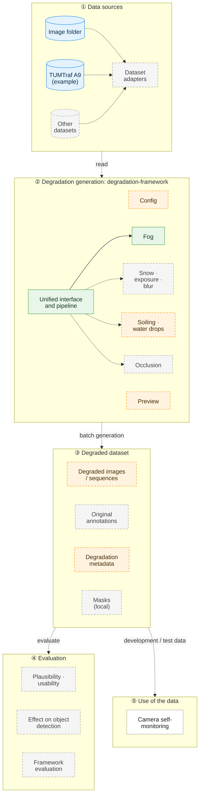

# Roadmap

**Thesis**: *Development and Evaluation of a Modular Framework for Generating Degraded Camera Data for Stationary Infrastructure Cameras*
(issued 2026-09-02, **submission 2027-03-02**).

**Purpose**: generate camera data with degradations of known type and intensity, reproducibly, for developing and evaluating camera self-monitoring methods.
The requirements derived from the task sheet are in [requirements.md](requirements.md) (IDs F / N / E / D); every milestone below refers to these IDs.

The module structure inside this repository is in [architecture.md](architecture.md), key decisions in [decisions/](decisions/README.md), weekly progress in [status/](status/).

## Overall architecture of the thesis project

Legend: green solid box = done; orange dashed box = in progress or partly done; grey dashed box = planned; blue = external data;
white dotted box = user of the data outside the thesis. Solid arrow = working; dashed arrow = planned.

| Part | Description | Requirements | Status |
|---|---|---|---|
| Dataset adapters | Connect different datasets' organisation (images, sequences) and annotation formats to the framework's common representation, and write them back in the original format on export; the framework is not tied to any one dataset, adding a dataset means adding one adapter | F1, F2, F8, N1 | Planned (M6) |
| Image folder | Plain images without annotations; can be processed today | F1 | ✅ |
| TUMTraf A9 | Roadside infrastructure camera dataset; the first adapter, as an example | F1 | Point clouds and calibration can be read, used by the fog to correct the depth (`degfw fog --lidar`); adapter for images, sequences, annotations planned (M6) |
| Other datasets | Adapters added as needed | F1 | — |
| Config | Dataset / subset, degradation types, intensity levels and seed are all written in a configuration file | F2, F4, F10 | Degradations, parameters, seed ✅; subset, intensity ❌ |
| Unified interface and pipeline | Parameter checks, per-image seeds, batch processing, metadata | F5, F9, N1 | Done (M0, M2) |
| Preview | See the effect before generating a whole dataset | F7 | Initial Gradio version, to be brought up to date (M7) |
| Fog | Clear2Fog: monocular depth + atmospheric scattering model; with LiDAR, the point clouds correct the depth scale | F3 | Done (M1); LiDAR correction 11-24 ([decision 0008](decisions/0008-fog-lidar-depth-scale.md)) |
| Snow, exposure, blur | The remaining global degradations | F3 | Planned (M5) |
| Soiling, water drops | Lens contamination: opaque / semi-transparent soiling, water drops | F3 | Code vendored, integration in progress (M4) |
| Occlusion | Local degradation | F3 | Planned (M4) |
| Degraded images / sequences | The degraded output data; sequences must be temporally consistent | F6, F8 | Images ✅; sequences ❌ |
| Original annotations | Exported together with the degraded images | F8 | Planned (M6) |
| Degradation metadata | Type, intensity, parameters and seed of every image | F8, F9 | Parameters and seed ✅; intensity ❌ |
| Masks | The area affected by a local degradation | F8 | Planned (M3, M4) |
| Plausibility, usability | Are the generated degradations credible, can they be used for self-monitoring | E1, E2 | Planned (M8) |
| Effect on object detection | How one object detection method performs under different degradations and intensities | E4 | Planned (M9) |
| Framework evaluation | Check against the requirements one by one | E3 | Planned (M10) |
| Camera self-monitoring methods | Users of the generated data, outside the scope of the thesis | — | — |

## Milestones

| | Milestone | Contents | Requirements | Status |
|---|---|---|---|---|
| M0 | Framework skeleton | `core/` (base class, parameters, registry, pipeline, I/O), command line, generic tests, initial Gradio version | N1, F5 | ✅ 2026-11-12 |
| M1 | Fog | Clear2Fog adapter and `degfw fog`; float32 pixel-identical to the original, `--fp16` about 20x faster | F3 | ✅ 2026-11-19 |
| M2 | Engineering structure | Third-party conventions, `degfw run` / `degfw weights`, split tests and regression tests; fixes for EXIF orientation, folder seeds, name collisions | N1, N2, F9 | ✅ 2026-11-19 |
| M3 | Interface extension | Degradations can output masks, several versions per image, get source and batch information (✅ 2026-11-25, [decision 0010](decisions/0010-context-one-fog-code.md)), stay consistent within a sequence, have intensity levels; the two output paths unified (the fog code is unified and gives the same results; the output formats still differ) | F4, F6, F8 | ⏳ In progress |
| M4 | Local degradations | Soiling and water drops integrated (with masks); occlusion | F3, F8 | Planned |
| M5 | Global degradations | Snow, poor exposure, blur; intensity level table for each degradation | F3, F4 | Planned |
| M6 | Dataset interface | Dataset adapter interface (common representation of images, sequences, annotations; annotations exported in their original format); first adapter TUMTraf A9 as an example; subset selection; export of degraded datasets with annotations | F1, F2, F8, F10, N1 | Planned |
| M7 | Preview | Update the Gradio UI: choose images, degradations, intensities; side-by-side preview | F7 | Planned |
| M8 | Plausibility and usability evaluation | Comparison with real degraded data; checks of intensity levels and labels | E1, E2 | Planned |
| M9 | Effect on object detection | One object detection method evaluated on clean data and on each degradation and intensity | E4 | Planned |
| M10 | Framework evaluation and final thesis | Check against the requirements one by one; finalise the thesis | E3 | Planned |

The research and justification (D1, D2) are written into the thesis alongside the development from now on; the reasons for the selected degradations become decision records.

## Schedule (proposal, adjusted to actual progress)

| Period | Milestones | Notes |
|---|---|---|
| 11-23 – 12-06 (2 weeks) | M3 interface extension | First look at how a few typical datasets (e.g. TUMTraf A9) organise data and annotations; the interface design needs this |
| 12-07 – 12-20 (2 weeks) | M4 local degradations | |
| 12-21 – 01-03 (2 weeks) | M5 global degradations | Includes holidays |
| 01-04 – 01-17 (2 weeks) | M6 dataset interface (TUMTraf A9 example), M7 preview | |
| 01-18 – 02-07 (3 weeks) | M8 plausibility and usability evaluation, M9 effect on object detection | Both can run in parallel |
| 02-08 – 03-02 (3 weeks) | M10 framework evaluation, final thesis | Includes buffer |

## Open decisions

1. **Which degradations, which method for each, and why** (D2, F3) → decision 0006.
   Candidate methods: in the local GitHub folder `Rain-Generation-Python` (rain), `fog_simulation-SFSU_synthetic` (another synthetic fog),
   `physical_lens_soiling` (lens soiling by physics-based simulation), plus the already vendored Clear2Fog and camera_contamination_simulation.
2. **How to extend the interface** (M3: masks, several versions per image, sequence consistency, intensity levels, unified output path) → decision 0007.
   Source and batch information is settled: [decision 0010](decisions/0010-context-one-fog-code.md).
3. **The fog's atmospheric light for images without sky** (M3, F6, F9): currently, images without sky use the average over the images of the same batch that have sky
   (the same in `degfw fog` and `degfw run fog`, [decision 0010](decisions/0010-context-one-fog-code.md)). Roadside cameras often see no sky, so the result depends on which other images are in the batch, and may jump from frame to frame within a sequence.
   Candidate approaches: make the atmospheric light a parameter that can be set directly (a given value or "auto"); estimate it once per camera or per sequence and share it;
   make the sky distance threshold (currently 1000 m) adjustable. Details of the method: [degradations/fog.md](degradations/fog.md).
4. **Dataset interface** (M6): common representation of images, sequences and annotations; copy annotations unchanged, or read them through the adapter and write them back;
   how to handle annotations of objects hidden by lens contamination; which subsets and cameras of the example dataset TUMTraf A9 to use.
5. **Intensity levels**: how many levels, which parameters each level maps to, and on what basis (F4).
   For the fog's visibility to be trustworthy, the depth scale must be right: with Depth Pro alone, the depth on roadside cameras is about 8 times too small ([decision 0008](decisions/0008-fog-lidar-depth-scale.md)).
   Datasets with LiDAR use `--lidar`; what to do without LiDAR (e.g. a scale from the camera calibration and the ground plane) is decided here as well.
6. **How to evaluate plausibility and usability**: which real data to compare with, which metrics (E1, E2).
   TSBOW and CoInfra in the local GitHub folder contain real adverse-weather data and are candidates for the comparison.
7. **Which object detection method and metrics** (E4).

## Optional engineering improvements

- **CI**: the quick tests need no GPU and no third-party dependencies, so they can run on GitHub Actions with only the core dependencies.
- **Split `weather/fog.py`**: about 280 lines now; when more is added, split it into a sub-package (model wrapper / registered degradation / command line).
- **Versions in the metadata**: add the code's git commit and the weight versions to each image's metadata, so reproducing a result needs no separate check (F9).
